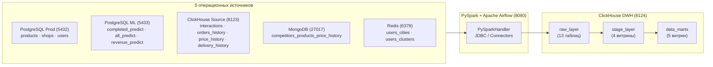

# SQL для анализа данных: DWH на ClickHouse, ETL на PySpark и витрины в Airflow

<!-- header -->
<p align="center">
  
  
  
  
  
  
  
  
</p>

**Подольский Филипп, магистратура ПМИ, ФМИ ПГНИУ**  
Практикум по курсу «SQL для анализа данных» (исходный шаблон заданий — [MakDaffi/sql-for-data-analysts](https://github.com/MakDaffi/sql-for-data-analysts), полные формулировки и словарь данных — в [`docs/assignments.md`](docs/assignments.md)).

В проекте развёрнуто трёхуровневое аналитическое хранилище данных (**ClickHouse DWH**: схемы `raw_layer` → `stage_layer` → `data_marts`), которое собирает данные интернет-магазина из **5 операционных СУБД** (`PostgreSQL Prod`, `PostgreSQL ML`, `ClickHouse Source`, `MongoDB`, `Redis`) с помощью **PySpark** и обновляет витрины по расписанию в **Apache Airflow**.

---

## Задания 1–5 → где что находится

| Задание | Что сделано | SQL-скрипты | Код Python и DAG'и Airflow |
|---|---|---|---|
| **Задание 1.** Инициализация источников | Генерация и заливка 13 таблиц в 5 операционных баз (`PostgreSQL prod`, `PostgreSQL ML`, `ClickHouse`, `MongoDB`, `Redis`) при старте проекта (`make run`) | — | [`scripts/init_raw_data.py`](scripts/init_raw_data.py)<br>[`src/data_generation/`](src/data_generation/)<br>[`src/data_handlers/`](src/data_handlers/) |
| **Задание 2.** Raw layer и PySpark | Поднят инстанс `clickhouse_dwh` (схемы `raw_layer`, `stage_layer`, `data_marts`), написан `PySparkHandler`, созданы 13 таблиц `raw_layer`, реализована полная перезапись (`TRUNCATE`) справочников и инкрементальная дозапись (`append` по watermark) таблиц событий | [`sql/raw_layer/00_init_schemas.sql`](sql/raw_layer/00_init_schemas.sql)<br>[`sql/raw_layer/01_raw_tables_ddl.sql`](sql/raw_layer/01_raw_tables_ddl.sql) | [`src/data_handlers/spark_handler.py`](src/data_handlers/spark_handler.py)<br>[`src/dwh/raw_layer_schemas.py`](src/dwh/raw_layer_schemas.py)<br>[`src/dwh/raw_loader.py`](src/dwh/raw_loader.py)<br>[`scripts/sync_raw_layer.py`](scripts/sync_raw_layer.py) |
| **Задание 3.** Оркестрация в Airflow | Развёрнут сервис Airflow в [`compose.yaml`](compose.yaml), упакован ежедневный пайплайн синхронизации всех 13 таблиц `raw_layer` (`@daily`) | — | [`dags/raw_layer/raw_layer_daily_dag.py`](dags/raw_layer/raw_layer_daily_dag.py)<br>[`src/dwh/sql_runner.py`](src/dwh/sql_runner.py) |
| **Задание 4.1.** Stage: цены конкурентов | Очищенная история цен товаров у конкурентов (`coalesce(price, cost, value)`) в локальном времени | [`sql/stage_layer/01_competitors_price_history.sql`](sql/stage_layer/01_competitors_price_history.sql) | [`dags/stage_layer/stage_competitors_price_history_dag.py`](dags/stage_layer/stage_competitors_price_history_dag.py) |
| **Задание 4.2.** Stage: актуальные ML-прогнозы | Три витрины с последними созданными прогнозами (`argMax(..., creation_date)`): `completed orders`, `all orders` и `revenue` (для моделей `catboost` и `TRex`) | [`sql/stage_layer/02_ml_predictions.sql`](sql/stage_layer/02_ml_predictions.sql) | [`dags/stage_layer/stage_ml_predictions_dag.py`](dags/stage_layer/stage_ml_predictions_dag.py) |
| **Задание 4.3.** Stage: интеракции по дням | Ежедневное количество интеракций по типам в локальном времени пользователя (`delivered` учитывается как `completed`) | [`sql/stage_layer/03_daily_interactions_by_type.sql`](sql/stage_layer/03_daily_interactions_by_type.sql) | [`dags/stage_layer/stage_daily_interactions_dag.py`](dags/stage_layer/stage_daily_interactions_dag.py) |
| **Задание 4.4.** Stage: полная таблица заказов | Широкая витрина `stage_layer.orders_full`: все 11 стадий заказа в локальном времени магазина, итоговый статус (`завершен`, `в процессе`, `отменен/потерян`), `ASOF LEFT JOIN` цен товара и доставки на момент заказа, кластер и города | [`sql/stage_layer/04_orders_full.sql`](sql/stage_layer/04_orders_full.sql) | [`dags/stage_layer/stage_orders_full_dag.py`](dags/stage_layer/stage_orders_full_dag.py) |
| **Задание 5.1.** Mart: разница цен с конкурентами | Средняя дневная разница между ценой товара нашей компании (`ASOF LEFT JOIN` истории цен) и ценой конкурентов | [`sql/data_marts/01_daily_competitors_price_diff.sql`](sql/data_marts/01_daily_competitors_price_diff.sql) | [`dags/data_marts/mart_daily_competitors_price_diff_dag.py`](dags/data_marts/mart_daily_competitors_price_diff_dag.py) |
| **Задание 5.2.** Mart: заказы по сегментам и городам | Ежемесячное количество заказов по ценовому кластеру пользователя (`low`, `middle`, `hight`) и городу магазина назначения | [`sql/data_marts/02_monthly_orders_by_cluster_city.sql`](sql/data_marts/02_monthly_orders_by_cluster_city.sql) | [`dags/data_marts/mart_monthly_orders_by_cluster_city_dag.py`](dags/data_marts/mart_monthly_orders_by_cluster_city_dag.py) |
| **Задание 5.3.** Mart: конверсия по неделям за год | Расчёт недельной конверсии интеракций на сайте в завершённые заказы с последующим усреднением по году | [`sql/data_marts/03_yearly_avg_weekly_conversion.sql`](sql/data_marts/03_yearly_avg_weekly_conversion.sql) | [`dags/data_marts/mart_yearly_avg_weekly_conversion_dag.py`](dags/data_marts/mart_yearly_avg_weekly_conversion_dag.py) |
| **Задание 5.4.** Mart: матрица «пользователь × товар» | Широкая pivot-витрина взаимодействий пользователей с товарами за последние 4 месяца (`customer_id` + колонки для каждого `product_id`) | [`sql/data_marts/04_user_product_orders_last_4m.sql`](sql/data_marts/04_user_product_orders_last_4m.sql) | [`src/dwh/marts_builder.py`](src/dwh/marts_builder.py)<br>[`dags/data_marts/mart_user_product_orders_last_4m_dag.py`](dags/data_marts/mart_user_product_orders_last_4m_dag.py) |
| **Задание 5.5.** Mart: ML-прогнозы против факта | Сравнение прогнозов заказов (`completed`, `all`) и выручки (`catboost`, `TRex`) с фактическими заказами и доходом (`order_price + delivery_price - prime_cost`) | [`sql/data_marts/05_ml_predictions_vs_fact.sql`](sql/data_marts/05_ml_predictions_vs_fact.sql) | [`dags/data_marts/mart_ml_predictions_vs_fact_dag.py`](dags/data_marts/mart_ml_predictions_vs_fact_dag.py)<br>[`scripts/build_dwh_layers.py`](scripts/build_dwh_layers.py) |

---

## Архитектура хранилища и 13 таблиц источников



| № | Таблица в `raw_layer` | Источник | Стратегия обновления в DWH | Поле watermark (для `incremental`) |
|---:|---|---|---|---|
| 1 | `raw_layer.products` | `postgres_main` | `TRUNCATE` + полная перезапись | — |
| 2 | `raw_layer.shops` | `postgres_main` | `TRUNCATE` + полная перезапись | — |
| 3 | `raw_layer.users` | `postgres_main` | Инкрементальная дозапись (`append`) | `registration_date` |
| 4 | `raw_layer.users_cities` | `redis` | `TRUNCATE` + полная перезапись | — |
| 5 | `raw_layer.users_clusters` | `redis` | `TRUNCATE` + полная перезапись | — |
| 6 | `raw_layer.shops_daily_completed_orders_predict` | `postgres_ml` | Инкрементальная дозапись (`append`) | `creation_date` |
| 7 | `raw_layer.shops_daily_all_orders_predict` | `postgres_ml` | Инкрементальная дозапись (`append`) | `creation_date` |
| 8 | `raw_layer.daily_revenue_predict` | `postgres_ml` | Инкрементальная дозапись (`append`) | `creation_date` |
| 9 | `raw_layer.interactions` | `clickhouse` | Инкрементальная дозапись (`append`) | `datetime` |
| 10 | `raw_layer.orders_history` | `clickhouse` | Инкрементальная дозапись (`append`) | `datetime` |
| 11 | `raw_layer.products_price_history` | `clickhouse` | Инкрементальная дозапись (`append`) | `effective_from` |
| 12 | `raw_layer.delivery_price_history` | `clickhouse` | Инкрементальная дозапись (`append`) | `effective_from` |
| 13 | `raw_layer.competitors_products_price_history` | `mongodb` | Инкрементальная дозапись (`append`) | `datetime` |

---

## Что исправлено в исходном шаблоне курса

В шаблоне преподавателя хендлеры и генераторы были оставлены без тестирования; при реализации пайплайна найдены и исправлены следующие проблемы:
1. **`src/data_generation/mongodb.py`:** в строке заполнения колонки `value` (`loc[tmp == 2, "value"] = loc[tmp == 0, "price"]`) из-за несовпадения индексов `tmp == 2` и `tmp == 0` pandas записывал `NaN` во все строки с `tmp == 2`. Исправлено на срез `tmp == 2`.
2. **`src/data_generation/clickhouse.py`:**
   * В `generate_orders_history_dataframe` сгенерированная колонка `shop_id` терялась при фильтрации колонок, из-за чего заказы невозможно было связать с магазином назначения и его часовым поясом в заданиях 4.4, 5.2 и 5.5 — `shop_id` сохранён в `orders_history`.
   * В `generate_interaction_history_dataframe` срез `.iloc[:size]` выполнялся до сортировки по времени после конкатенации `[click, add_to_cart, purchased, paid]`, из-за чего при небольших `size` события `purchased` и `paid` полностью отрезались. Добавлена сортировка по `datetime` перед срезом.
   * В `gen_delivery_price_history_dataframe` в одну колонку `object_id` объединялись строковые названия городов и 128-битные `int` идентификаторов магазинов — добавлено приведение к `str`.
3. **`src/data_handlers/pg_handler.py`:** добавлен драйвер `psycopg[binary]` в `pyproject.toml`, сериализация `UUID` и 128-битных `int` (`shop_id` из `uuid4().int` превышает 64-битный `BIGINT`), вывод типа `DATE` для дат и ограничение `chunksize` с учётом лимита PostgreSQL в 65 535 параметров на один `INSERT`.
4. **`src/data_handlers/clickhouse_handler.py`:** в `create_table` добавлено обязательное для ClickHouse выражение `ENGINE = MergeTree() ORDER BY ...` и автогенерация DDL по схеме DataFrame.
5. **`src/data_handlers/mongodb_handler.py`:** добавлено приведение `UUID` и `datetime.date` при конвертации DataFrame в BSON-документы.

---

## Структура репозитория

```
├── README.md                                          ← описание архитектуры, навигация по заданиям и запуск
├── docs/
│   └── assignments.md                                 ← исходный текст заданий 1–5 и словарь данных курса
├── compose.yaml                                       ← 5 БД-источников + ClickHouse DWH + Apache Airflow
├── Makefile                                           ← команды make init, make run, make sync-raw, make build-marts
├── pyproject.toml                                     ← зависимости проекта (uv / Python 3.12+)
├── .env.example                                       ← шаблон переменных окружения и масштаба генерации
├── data/
│   └── products.csv                                   ← справочник из 1 000 товаров (база для генерации)
├── scripts/
│   ├── init_raw_data.py                               ← Задание 1: генерация и заливка 13 таблиц в 5 источников
│   ├── sync_raw_layer.py                              ← Задание 2: CLI загрузки источников в raw_layer через PySpark
│   └── build_dwh_layers.py                            ← Задания 4–5: последовательная сборка всех витрин stage и marts
├── src/
│   ├── README.md                                      ← описание всех модулей пакета src/
│   ├── data_generation/                               ← генераторы синтетических данных для 5 источников
│   ├── data_handlers/                                 ← коннекторы к БД и PySparkHandler (spark_handler.py)
│   └── dwh/                                           ← схемы raw_layer, RawLayerLoader, sql_runner, marts_builder
├── sql/
│   ├── README.md                                      ← навигация по всем SQL-скриптам хранилища
│   ├── raw_layer/
│   │   ├── 00_init_schemas.sql                        ← создание схем raw_layer, stage_layer, data_marts
│   │   └── 01_raw_tables_ddl.sql                      ← Задание 2: DDL всех 13 таблиц в raw_layer
│   ├── stage_layer/
│   │   ├── 01_competitors_price_history.sql           ← Задание 4.1: история цен товаров у конкурентов
│   │   ├── 02_ml_predictions.sql                      ← Задание 4.2: актуальные ML-прогнозы (completed, all, revenue)
│   │   ├── 03_daily_interactions_by_type.sql          ← Задание 4.3: интеракции по типам за день (delivered -> completed)
│   │   └── 04_orders_full.sql                         ← Задание 4.4: широкая таблица заказов (локальное время + ASOF JOIN)
│   └── data_marts/
│       ├── 01_daily_competitors_price_diff.sql        ← Задание 5.1: средняя разница цен с конкурентами за день
│       ├── 02_monthly_orders_by_cluster_city.sql      ← Задание 5.2: заказы по ценовому сегменту и городу за месяц
│       ├── 03_yearly_avg_weekly_conversion.sql        ← Задание 5.3: средняя недельная конверсия за год
│       ├── 04_user_product_orders_last_4m.sql         ← Задание 5.4: матрица заказов пользователей по товарам за 4 мес.
│       └── 05_ml_predictions_vs_fact.sql              ← Задание 5.5: сравнение ML-прогнозов с фактом (заказы и выручка)
└── dags/
    ├── README.md                                      ← таблица всех 10 DAG'ов Airflow
    ├── raw_layer/
    │   └── raw_layer_daily_dag.py                     ← Задание 3: ежедневный DAG обновления raw_layer
    ├── stage_layer/                                   ← Задание 4: 4 DAG'а обновления витрин stage_layer
    └── data_marts/                                    ← Задание 5: 5 DAG'ов обновления витрин data_marts
```

---

## Как запустить и проверить

```bash
git clone https://github.com/Meta1rus/sql-for-data-analysts.git
cd sql-for-data-analysts

# 1. Установить зависимости (через uv)
make init

# 2. Поднять контейнеры (5 источников + ClickHouse DWH + Airflow) и заполнить источники (Задание 1)
make run

# 3. Перенести все 13 таблиц в схему raw_layer DWH через PySpark (Задание 2)
make sync-raw

# 4. Собрать все витрины stage_layer (Задание 4) и data_marts (Задание 5)
make build-marts
```

Веб-интерфейс **Apache Airflow** после `make run` доступен по адресу `http://localhost:8080`, HTTP-интерфейс **ClickHouse DWH** — на `http://localhost:8124`.
